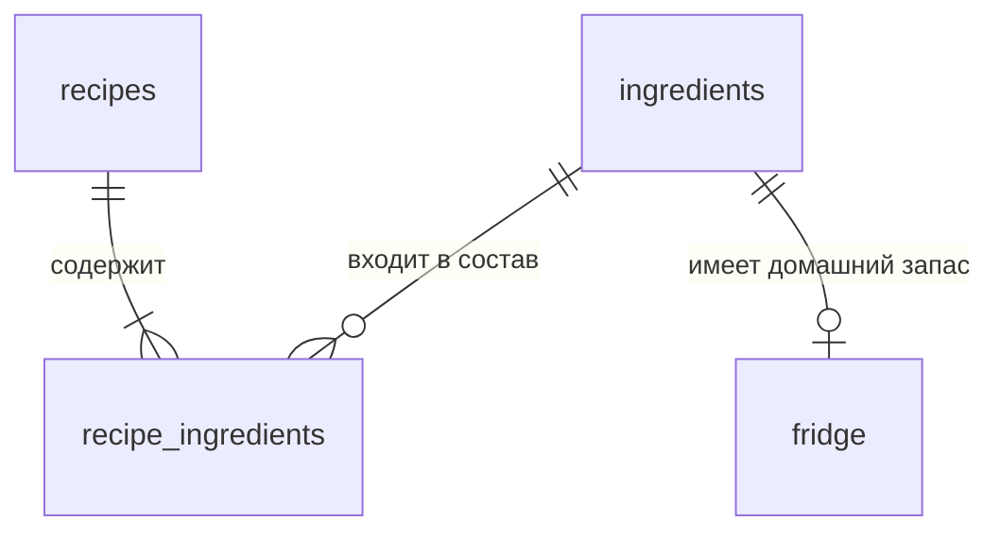

# Техническое задание: «Что приготовить?»

**Автор:** Чайка Алла  
**Дата версии:** 12 ноября 2026 года  
**Версия:** 1.0  
**Тип продукта:** индивидуальное настольное приложение на Python, PyQt6 и SQLite.

Документ определяет объём первой версии, пользовательские сценарии, функции, экраны, структуру данных, расчёты, ограничения и порядок приёмки. Изменения требований оформляются по правилам раздела 15.

## 1. Назначение и пользователь

Приложение предназначено для одного пользователя, который ведёт собственную книгу рецептов и домашние запасы. 

Пользователь должен иметь возможность выбрать блюдо по имеющимся продуктам, времени приготовления и числу персон, рассчитать недостающие продукты и сравнить рецепты по калорийности, белкам, жирам или углеводам одной порции.

## 2. Зафиксированный объём первой версии

### 2.1. Обязательные возможности

1. Создание, просмотр, редактирование и удаление рецептов.
2. Хранение категории, инструкции, базового числа порций, времени и состава рецепта.
3. Необязательная фотография: добавление при создании или позже, замена и удаление.
4. Общий справочник ингредиентов с единицей измерения и необязательными данными КБЖУ.
5. Общий «Холодильник» для всех домашних продуктов с количественным учётом.
6. Поиск рецептов, фильтры по категории и времени приготовления.
7. Добавление рецепта в избранное и просмотр избранного.
8. Настройка предпочитаемого количества персон и пересчёт состава рецепта.
9. Подбор блюд и расчёт недостающего количества каждого ингредиента.
10. Автоматический расчёт КБЖУ по ингредиентам и сортировка по одному выбранному показателю.
11. Сохранение списка покупок для одного рецепта в TXT и списка рецептов в CSV.
12. Один таймер приготовления с запуском, паузой и сбросом.
13. Сохранение пользовательских данных между запусками приложения.

### 2.2. Желательные возможности

Дополнительные настройки внешнего вида. Эта функция не является условием готовности обязательной версии. Её точный состав будет согласован отдельно после работающей основы.

### 2.3. За пределами первой версии

- Сроки годности и учёт разных партий одного продукта.
- Автоматическое списание продуктов после приготовления.
- Перевод между граммами, миллилитрами, штуками, ложками и другими единицами.
- Получение рецептов или КБЖУ из интернета, сканирование этикеток и распознавание фотографий.
- Подбор по диапазонам КБЖУ, персональные нормы питания и диетические рекомендации.
- Меню на неделю, общий список покупок для нескольких рецептов, импорт CSV.

## 3. Основные сценарии

### UC-01. Добавить рецепт без фотографии и дополнить его позже

1. Пользователь открывает редактор нового рецепта.
2. Указывает название, категорию, инструкцию, время и базовое число порций.
3. Выбирает ингредиенты из справочника и указывает количество каждого.
4. Если ингредиента ещё нет, создаёт его через кнопку «Новый ингредиент».
5. Сохраняет рецепт без фотографии. В карточке появляется стандартная заглушка.
6. Позже открывает тот же рецепт на редактирование и выбирает фотографию.
7. После сохранения фотография отображается в существующей карточке; дубликат рецепта не создаётся.

### UC-02. Добавить домашние запасы

1. Пользователь открывает «Холодильник» и выбирает «Добавить продукт».
2. Выбирает ингредиент из справочника или создаёт новый.
3. Вводит доступное количество в закреплённой за ингредиентом единице.
4. Сохраняет запас и видит его в общей таблице.

Добавление ингредиента в справочник или рецепт само по себе не означает, что продукт есть дома.

### UC-03. Подобрать блюдо

1. Пользователь открывает «Подбор».
2. Проверяет число персон, при необходимости меняет его и задаёт ограничение по времени.
3. Запускает подбор.
4. Программа рассчитывает потребность и нехватку продуктов отдельно для каждого рецепта.
5. Настроена сортировка с фильтрами (04)
6. Пользователь открывает карточку подходящего блюда и при необходимости сохраняет список покупок.

### UC-04. Сравнить рецепты по КБЖУ

1. Пользователь выбирает показатель: калории, белки, жиры или углеводы.
2. Выбирает направление сортировки.
3. Программа сортирует рецепты по значению выбранного показателя на одну порцию.
4. Рецепты с неполными исходными данными отображаются в конце с пометкой «КБЖУ не рассчитано».

## 4. Функциональные требования

### FR-01. Справочник ингредиентов

- Ингредиент содержит название, одну единицу измерения и сведения КБЖУ.
- Допустимые единицы первой версии: `г`, `мл`, `шт`.
- КБЖУ задаётся на 100 г, 100 мл или одну штуку соответственно.
- Единица и база расчёта явно подписываются рядом с полями КБЖУ.
- Пользователь может не указывать КБЖУ. Неизвестные значения отличаются от введённых нулей.
- При заполнении КБЖУ должны быть указаны все четыре показателя. Частичное заполнение не сохраняется: предлагается заполнить недостающие поля или очистить всю группу.
- Отрицательные значения КБЖУ не допускаются.
- Название после удаления пробелов по краям не может быть пустым.
- Для поиска дублей пробелы по краям удаляются, повторяющиеся пробелы заменяются одним, регистр не учитывается.
- При вводе существующего названия пользователь получает предложение выбрать уже созданный ингредиент.
- Название и КБЖУ можно редактировать. Их изменение отражается во всех связанных рецептах.
- Единица существующего ингредиента не меняется, чтобы сохранённые количества не изменили смысл.

### FR-02. Создание и редактирование рецептов

- Обязательны название, категория, инструкция, положительное целое время приготовления, положительное целое базовое число порций и хотя бы один ингредиент.
- Для каждого ингредиента указывается положительное количество.
- Один ингредиент не может встречаться в составе одного рецепта дважды. При повторном выборе показывается сообщение с предложением изменить существующую строку.
- Единица в строке состава берётся из справочника и отдельно не редактируется.
- Фотография необязательна.
- При редактировании поля заполняются текущими значениями. Можно менять сведения и состав, добавлять и удалять строки ингредиентов.
- «Сохранить» обновляет существующий рецепт с тем же идентификатором. Избранное сохраняется.
- «Отмена» не меняет рецепт. При закрытии редактора с несохранёнными изменениями предлагается продолжить редактирование или отказаться от изменений.
- Некорректные поля подсвечиваются; сообщение объясняет, что исправить. Уже введённый текст остаётся в редакторе.

### FR-03. Фотография рецепта

- Рецепт без фотографии отображается с общей заглушкой.
- Доступны «Добавить фото», «Заменить фото» и «Убрать фото».
- Выбор и снятие фотографии вступают в силу после сохранения рецепта.
- Отмена выбора файла сохраняет прежнюю фотографию.
- Выбранное изображение проверяется на возможность чтения, копируется в папку данных приложения, а в БД хранится относительный путь к копии.
- Перемещение или удаление исходной фотографии пользователем не должно ломать карточку.
- Ошибка чтения или копирования файла не изменяет ранее сохранённый рецепт; редактор сохраняет введённые значения и показывает причину ошибки.
- Изображение масштабируется с сохранением пропорций.

### FR-04. Домашние запасы

- В холодильнике хранится не более одной строки для каждого ингредиента.
- Вводится доступное количество; единица отображается из справочника.
- Допускаются нулевое и положительное количество. Отрицательный запас не сохраняется.
- При редактировании новое количество заменяет прежнее, а не прибавляется к нему.
- Если выбран уже имеющийся в холодильнике ингредиент, программа предлагает изменить его текущий запас и показывает прежнее значение.
- Удаление запаса требует подтверждения и не удаляет ингредиент из справочника.
- Отсутствующий в холодильнике ингредиент имеет доступное количество ноль при подборе.
- Просмотр рецептов, подбор и работа таймера не списывают продукты.

### FR-05. Избранное

- В карточке рецепта имеется переключатель «В избранное» / «Убрать из избранного».
- Состояние сохраняется сразу и восстанавливается после перезапуска.
- На вкладке рецептов имеется фильтр «Только избранное».
- Редактирование рецепта не сбрасывает отметку.
- Если список избранного пуст, отображается поясняющее сообщение.

### FR-06. Предпочитаемое количество персон

- В настройках хранится предпочитаемое количество персон.
- Допустимо целое число от 1 до 20, начальное значение 2.
- Настройка сохраняется после закрытия приложения.
- При новом открытии карточки из каталога и при открытии подбора это число подставляется автоматически.
- В карточке и подборе число можно изменить для текущего просмотра. Такое изменение не перезаписывает общую настройку.
- Карточка, открытая из результатов подбора, получает число персон из этого подбора.
- Базовое число порций и исходные количества в самом рецепте не меняются при пересчёте.

### FR-07. Поиск и подбор

- Поиск выполняется по подстроке названия без учёта регистра.
- Категория выбирается из списка; вариант «Все» отключает соответствующий фильтр.
- Ограничение времени включает рецепты с временем, меньшим или равным указанному пределу.
- Подбор учитывает выбранное число персон и сравнивает каждый рецепт с одними и теми же текущими запасами независимо от других рецептов.
- Для каждого результата показываются статус доступности и число недостающих ингредиентов.
- В карточке для каждого ингредиента показываются «Нужно», «Есть» и «Не хватает» с единицей измерения.
- Предусматриваются состояния «Рецептов пока нет» и «По заданным условиям ничего не найдено».

### FR-08. Расчёт и сортировка КБЖУ

- Данные блюда вычисляются по составу; пользователь не вводит КБЖУ рецепта вручную.
- Отображаются значения на одну порцию и на выбранное число персон.
- Сортировка выполняется по одному из четырёх показателей на одну порцию, по возрастанию или убыванию.
- Если хотя бы один ингредиент имеет неизвестное КБЖУ, все итоговые показатели блюда помечаются «КБЖУ не рассчитано».
- Неизвестные показатели не заменяются нулями; такие рецепты помещаются после всех рассчитанных при обоих направлениях сортировки.
- Сортировка не исключает рецепты с неизвестным КБЖУ из списка.
- После изменения состава, базового числа порций или данных ингредиента показатели пересчитываются.
- Самостоятельные числовые поля с рассчитанным КБЖУ в таблице рецептов не хранятся, чтобы избежать устаревших итогов.

### FR-09. Файлы

- Список покупок TXT создаётся для одного рецепта и выбранного числа персон.
- Он содержит название рецепта, число персон и только недостающие ингредиенты с количествами и единицами.
- Если покупать ничего не требуется, программа сообщает об этом.
- CSV содержит по одной строке на рецепт из текущего отображаемого списка с учётом фильтров и сортировки. Формат определён в разделе 9.
- Место сохранения выбирается стандартным диалогом.
- При отмене диалога файл не создаётся. При ошибке записи показывается понятное сообщение; данные приложения не меняются.

### FR-10. Один таймер

Согласованы запуск, пауза и сброс одного таймера в отдельном окне. При закрытии карточки отсчёт продолжается, остаток отображается в главном окне. Полное поведение определено в разделе 5.8.

## 5. Требования к интерфейсу

Главное окно содержит четыре вкладки. Рецепты отображаются таблицей; фотографии доступны в карточках. Таймер работает в отдельном окне и продолжает отсчёт при закрытии карточки рецепта.

### 5.1. Главное окно и общие правила

- Заголовок: «Что приготовить?».
- Вкладки в порядке слева направо: «Рецепты», «Справочник», «Холодильник», «Подбор».
- При запуске открывается «Рецепты».
- Меню «Файл»: «Новый рецепт», «Экспорт рецептов в CSV», «Выход».
- Меню «Инструменты»: «Настройки», «Таймер».
- Меню «Справка»: краткая инструкция пользователя и «О программе».
- Кнопки, требующие выбранной строки, неактивны, когда строка не выбрана. В таблицах выбирается одна строка целиком; прямое редактирование ячеек просмотра запрещено.
- Двойной щелчок по рецепту открывает карточку; по ингредиенту — редактор справочника; по запасу — редактор количества.
- Редакторы открываются отдельными диалогами. Повторное открытие одного редактора до его закрытия не допускается.
- Обычные действия выполняются кнопками, без обязательного знания горячих клавиш.
- Удаление подтверждается диалогом с названием удаляемого объекта. Отмена оставляет данные без изменений.
- Закрытие редактора через крестик и Escape обрабатывается как «Отмена». При несохранённых изменениях предлагается «Продолжить редактирование» или «Не сохранять»; случайное закрытие не должно молча терять ввод.

### 5.2. Вкладка «Рецепты»

Рецепты отображаются таблицей. Фотография показывается в отдельной карточке рецепта.

- Поиск по названию, список категорий с вариантом «Все», необязательное ограничение времени, флажок «Только избранное».
- Все активные фильтры применяются одновременно. Изменение поиска, категории, ограничения времени или флажка обновляет список; «Сбросить фильтры» очищает поиск и ограничения, но сохраняет выбранную сортировку.
- Сортировка: название, время, калории, белки, жиры, углеводы. Для числовых показателей выбирается возрастание или убывание; по умолчанию — название по алфавиту.
- Столбцы: название, категория, время в минутах, базовые порции, калории, белки, жиры, углеводы на одну порцию, отметка избранного.
- У неизвестных КБЖУ выводится «—» с пояснением «КБЖУ не рассчитано».
- Кнопки: «Добавить рецепт», «Открыть», «Редактировать», «Удалить», «Экспорт CSV».
- Экспортируется текущий отображаемый список с учётом фильтров и порядка сортировки. Для экспорта всех записей пользователь сбрасывает фильтры. При пустом списке экспорт недоступен.
- Пустая база: «Рецептов пока нет. Добавьте первый рецепт» и кнопка добавления.
- Пустой результат фильтра: «Рецепты не найдены» и кнопка сброса фильтров.
- Карточка, открытая из этой вкладки, получает предпочитаемое число персон из настроек.

### 5.3. Вкладка «Справочник»

- Поиск по названию ингредиента без учёта регистра.
- Столбцы: название, единица измерения, база КБЖУ, калории, белки, жиры, углеводы.
- База явно отображается как «на 100 г», «на 100 мл» или «на 1 шт»; неизвестные показатели отмечаются «—».
- Кнопки: «Добавить ингредиент», «Редактировать», «Удалить».
- Редактирование изменяет сведения общей записи ингредиента. Диалог содержит пояснение: «Изменения будут учтены во всех рецептах с этим ингредиентом».
- Удалить можно только ингредиент, на который не ссылаются рецепты и холодильник. Иначе показывается причина: «Ингредиент используется в рецептах» и/или «Ингредиент добавлен в холодильник»; автоматического удаления связанных данных нет.
- Пустой справочник: «Добавьте ингредиенты здесь или при создании рецепта».

### 5.4. Вкладка «Холодильник»

- Название относится ко всем домашним запасам; мест хранения и сроков годности нет.
- Поиск по названию; столбцы: продукт, доступное количество, единица.
- Кнопки: «Добавить продукт», «Изменить количество», «Удалить из холодильника».
- Форма запаса: выбор ингредиента, кнопка «Новый ингредиент», доступное количество, неизменяемая подпись единицы, кнопки «Сохранить» и «Отмена».
- При редактировании ингредиент закреплён, меняется только количество.
- При выборе уже имеющегося продукта показываются текущий запас и предупреждение, что введённое значение заменит его. Новая строка не создаётся.
- Создание нового ингредиента сохраняет его в справочник отдельным действием. Если затем отменить добавление запаса, ингредиент остаётся в справочнике, но записи в холодильнике не появляется.
- Пустое состояние: «Домашние запасы пока не добавлены. При подборе доступное количество продуктов считается нулевым».

### 5.5. Вкладка «Подбор»

- Число персон, необязательный предел времени и флажок «Только рецепты, для которых всё есть».
- При первом открытии число персон берётся из настроек; предел времени отключён, флажок доступных рецептов выключен.
- Кнопка «Подобрать» запускает расчёт по сохранённым рецептам и текущим запасам.
- По умолчанию показываются и полностью доступные рецепты, и требующие покупок; первыми идут рецепты с меньшим числом недостающих ингредиентов, затем по названию.
- Дополнительно можно выбрать сортировку по времени или одному показателю КБЖУ одной порции, в обе стороны.
- Столбцы результатов: название, время, статус («Всё есть» / «Нужно купить»), число недостающих ингредиентов, КБЖУ одной порции.
- Кнопка «Открыть рецепт» и двойной щелчок открывают карточку с числом персон из подбора.
- Изменение числа персон, ограничений, сохранённых рецептов, справочника или запасов очищает устаревший результат и выводит «Условия изменились. Нажмите “Подобрать”». Переключение избранного только обновляет его отображение.
- Изменение только сортировки переставляет актуальные результаты, повторный расчёт не требуется.
- При отсутствии результатов: «Нет рецептов по выбранным условиям». Пустые запасы сами по себе не скрывают рецепты, если флажок «Только рецепты, для которых всё есть» выключен.

### 5.6. Карточка и редактор рецепта

**Карточка:** название, категория рядом с описанием, фотография или заглушка, время, базовое число порций, переключатель числа персон, инструкция, таблица ингредиентов «Продукт / Нужно / Есть / Не хватает / Единица», КБЖУ одной порции и всего выбранного количества порций.

Кнопки: «В избранное» / «Убрать из избранного», «Редактировать», «Список покупок TXT», «Таймер», «Закрыть». При смене числа персон количества и показатели в карточке обновляются сразу. Избранное сохраняется сразу; просмотр и пересчёт не меняют исходный рецепт или холодильник.

**Редактор:** название, категория из фиксированного списка, время в минутах, базовое число порций, многострочная инструкция, предпросмотр фотографии с кнопками «Выбрать / Заменить» и «Убрать», таблица состава, «Добавить строку», «Удалить строку», «Новый ингредиент», «Сохранить», «Отмена».

- В новом рецепте категория по умолчанию — «Другое».
- В новом рецепте название, инструкция и время пусты; базовое число порций равно 2, фотография отсутствует, состав пуст. Для сохранения пользователь должен заполнить обязательные поля и добавить ингредиенты. Время не подставляется автоматически из минимального значения поля.
- Строка состава содержит выбор ингредиента из справочника с поиском по названию, количество и подпись единицы.
- «Новый ингредиент» открывает общий редактор ингредиента; после успешного сохранения продукт становится доступен в выборе и подставляется в текущую строку.
- Создание ингредиента — самостоятельное сохранение. Отмена самого рецепта не удаляет уже созданный продукт из справочника и не добавляет его в холодильник.
- Полей ручного ввода КБЖУ блюда нет; значения вычисляются по составу.
- После сохранения редактор закрывается, списки обновляются, открытая карточка показывает новые данные.
- Ошибка проверки или записи оставляет редактор открытым и сохраняет введённые значения.

### 5.7. Редактор ингредиента и настройки

**Ингредиент:** название, единица (`г`, `мл`, `шт`), флажок «КБЖУ известно», четыре числовых поля КБЖУ, подпись базы расчёта, «Сохранить», «Отмена».

- В новом продукте КБЖУ по умолчанию неизвестно: поля неактивны и сохраняются как NULL.
- Единица нового ингредиента по умолчанию — `г`; до первого сохранения её можно сменить. Название пустое. После включения КБЖУ новые поля пусты и требуют заполнения.
- После включения флажка все четыре поля доступны и обязательны. Пустое значение недопустимо, введённый ноль допустим.
- Снятие флажка отключает поля; после сохранения все четыре показателя становятся неизвестными.
- В режиме редактирования единица заблокирована; название и КБЖУ доступны.
- Ошибки показываются рядом с соответствующими полями; сообщение о дубле называет существующий продукт.

**Настройки:** поле «Предпочитаемое число персон», «Сохранить», «Отмена»; границы 1–20 и начальное значение 2. Изменение применяется к последующим открытиям карточек и подбора. Уже открытая карточка сохраняет выбранное для неё число персон.

### 5.8. Таймер

- Отдельное немодальное окно, доступное из меню и карточки рецепта. Во всём приложении существует один таймер; повторное открытие показывает его текущее состояние.
- Продолжительность задаётся целым числом минут; границы 1–180, начальное значение 10. Открытие из рецепта не заменяет заданную длительность его временем приготовления.
- Остаток показывается в формате минут и секунд (ММ:СС; для длительности от 100 минут — три цифры минут). Кнопки: «Старт», «Пауза / Продолжить», «Сброс».
- До запуска можно изменить длительность. Во время отсчёта и паузы поле длительности заблокировано.
- «Старт» начинает отсчёт; повторный запуск уже работающего таймера недоступен.
- «Пауза» сохраняет остаток; «Продолжить» возобновляет отсчёт с остатка.
- «Сброс» останавливает таймер и возвращает выбранную длительность. После сброса её можно изменить.
- При нуле отсчёт останавливается, один раз появляется сообщение «Время приготовления истекло»; отрицательное время не отображается. После завершения «Старт» доступен и запускает новый отсчёт полной заданной длительности.
- Закрытие карточки или окна таймера не останавливает отсчёт. В строке состояния главного окна видны остаток и признак паузы; щелчок открывает окно таймера.
- При выходе из приложения с запущенным или приостановленным таймером предлагается подтвердить остановку. Отмена оставляет приложение и таймер в текущем состоянии. После перезапуска таймер не восстанавливается.
- Таймер не привязан к записи рецепта, не меняет запасы и не включает отдельную историю занятий.

### 5.9. Проверки интерфейса

| Ситуация | Ожидаемое поведение |
| --- | --- |
| Запустить приложение с пустой БД | Доступны четыре вкладки, показаны пояснения и кнопки добавления |
| Не выбирать строку списка | Открытие, редактирование и удаление недоступны |
| Отменить удаление | Запись и связи сохранены |
| Создать ингредиент из редактора, отменить рецепт | Ингредиент остаётся в справочнике; рецепта и запаса нет |
| Создать ингредиент из холодильника, отменить запас | Ингредиент остаётся в справочнике; запаса нет |
| Изменить состав или холодильник после подбора | Старый результат очищен, предлагается пересчитать |
| Отфильтровать рецепты и экспортировать CSV | В файле только показанные рецепты в текущем порядке |
| Попытаться удалить используемый ингредиент | Удаление запрещено, показана причина |
| Закрыть карточку с работающим таймером | Отсчёт продолжается, остаток виден в главном окне |
| Открыть таймер повторно | Показан тот же отсчёт, второй таймер не создан |

## 6. Ограничения и проверки ввода

| Поле | Допустимые значения |
| --- | --- |
| Название рецепта | 1–100 символов после удаления пробелов по краям |
| Название ингредиента | 1–80 символов после нормализации |
| Инструкция | 1–10 000 символов, включая переводы строк |
| Категория | Одно из шести фиксированных значений; по умолчанию «Другое» |
| Время рецепта и предел времени поиска | Целое 1–1440 минут; выключенный предел не ограничивает список |
| Базовые порции, число персон, предпочтение | Целое 1–20; по умолчанию 2 |
| Количество ингредиента в базовом рецепте | 0,01–999 999,99 в его единице, максимум два знака после запятой |
| Доступный запас | 0–999 999,99, максимум два знака после запятой |
| Каждое поле КБЖУ | Все четыре неизвестны либо каждое 0–99 999,99, до двух знаков после запятой |
| Состав одного рецепта | 1–50 различных ингредиентов |
| Фотография | PNG, JPG или JPEG, не более 10 МиБ; файл должен успешно декодироваться как изображение |
| Таймер | Целое 1–180 минут, по умолчанию 10 |

Ограничение входного количества не обрезает вычисленные количества: после пересчёта порций они могут превышать верхнюю границу поля ввода и должны показываться полностью.

Названия рецептов могут повторяться: разные версии блюда отличаются идентификаторами. Названия ингредиентов после нормализации уникальны. Замена `ё` на `е` и распознавание синонимов не выполняются; «Молоко» и «Молоко 3,2%» могут быть разными продуктами.

Формы принимают неотрицательные конечные десятичные значения, без разделителей тысяч. Строки, содержащие только пробелы, не считаются заполненными. При ошибке сохраняется введённое содержимое редактора; БД не изменяется. Проверки выполняются перед началом транзакции и подкрепляются ограничениями БД там, где это применимо.

## 7. Данные и связи

Один файл SQLite хранит справочник, рецепты, запасы и настройки. В первой версии каждый рецепт содержит категорию как поле из согласованного фиксированного списка: «Завтраки», «Супы», «Основные блюда», «Салаты», «Десерты», «Другое». Категория отображается в карточке рядом с описанием. Добавление и редактирование категорий пользователем в первую версию не входят. Отдельная таблица категорий не требуется.

### 7.1. `ingredients` — справочник

| Поле | Тип SQLite | Назначение и ограничения |
| --- | --- | --- |
| `id` | INTEGER | Первичный ключ |
| `name` | TEXT | NOT NULL, непустое отображаемое название |
| `name_key` | TEXT | NOT NULL, UNIQUE, нормализованное название |
| `unit` | TEXT | NOT NULL, CHECK: `г`, `мл` или `шт` |
| `calories` | REAL | Ккал на базу измерения, NULL или значение >= 0 |
| `protein` | REAL | Белки, г на базу измерения, NULL или значение >= 0 |
| `fat` | REAL | Жиры, г на базу измерения, NULL или значение >= 0 |
| `carbs` | REAL | Углеводы, г на базу измерения, NULL или значение >= 0 |

Ограничение целостности: четыре поля КБЖУ должны быть либо все NULL, либо все заполнены неотрицательными значениями. База измерения определяется `unit`: 100 г, 100 мл или 1 шт.

### 7.2. `recipes` — рецепты

| Поле | Тип SQLite | Назначение и ограничения |
| --- | --- | --- |
| `id` | INTEGER | Первичный ключ |
| `name` | TEXT | NOT NULL, непустое название |
| `category` | TEXT | NOT NULL, CHECK (category IN ('Завтраки', 'Супы', 'Основные блюда', 'Салаты', 'Десерты', 'Другое')) |
| `instructions` | TEXT | NOT NULL, непустая инструкция |
| `base_portions` | INTEGER | NOT NULL, положительное число базовых порций |
| `cooking_minutes` | INTEGER | NOT NULL, положительное время в минутах |
| `image_path` | TEXT | Относительный путь к фото, NULL при отсутствии |
| `is_favorite` | INTEGER | NOT NULL, CHECK IN (0, 1), DEFAULT 0 |

### 7.3. `recipe_ingredients` — состав

| Поле | Тип SQLite | Назначение и ограничения |
| --- | --- | --- |
| `recipe_id` | INTEGER | NOT NULL, внешний ключ на `recipes.id`, ON DELETE CASCADE |
| `ingredient_id` | INTEGER | NOT NULL, внешний ключ на `ingredients.id`, ON DELETE RESTRICT |
| `quantity` | REAL | NOT NULL, CHECK > 0, количество на базовые порции |

Первичный ключ составной: (`recipe_id`, `ingredient_id`). Это запрещает повтор одного ингредиента в составе одного рецепта.

### 7.4. `fridge` — все домашние запасы

| Поле | Тип SQLite | Назначение и ограничения |
| --- | --- | --- |
| `ingredient_id` | INTEGER | Первичный и внешний ключ на `ingredients.id`, ON DELETE RESTRICT |
| `quantity` | REAL | NOT NULL, CHECK >= 0, доступное количество |

### 7.5. `app_settings` — настройки

| Поле | Тип SQLite | Назначение и ограничения |
| --- | --- | --- |
| `id` | INTEGER | Первичный ключ, CHECK (id = 1), одна строка |
| `preferred_servings` | INTEGER | NOT NULL, CHECK (preferred_servings BETWEEN 1 AND 20), DEFAULT 2 |

Эта таблица хранит настройки одного локального пользователя и не имеет внешних ключей.

### 7.6. Кардинальности связей

- `recipes` → `recipe_ingredients`: один ко многим; у сохранённого рецепта не менее одной строки состава.
- `ingredients` → `recipe_ingredients`: один ко многим; ингредиент может пока не использоваться ни в одном рецепте.
- Через `recipe_ingredients` рецепты и ингредиенты связаны отношением многие ко многим.
- `ingredients` → `fridge`: один к нулю или одному. Запас может отсутствовать, но не может существовать без ингредиента.
- Обязательное наличие строки состава проверяется при сохранении рецепта в одной транзакции; одних внешних ключей для этого недостаточно.

### 7.7. Правила целостности

1. Рецепт и его состав сохраняются одной транзакцией. Ошибка любой части отменяет изменения целиком.
2. Пустой состав блокирует сохранение.
3. Удаление рецепта удаляет только сам рецепт и его строки состава; справочник и запасы сохраняются.
4. Удаление из холодильника удаляет только запас.
5. Нельзя удалить из справочника ингредиент, на который ссылаются состав или холодильник.
6. Единица существующего продукта неизменна.
7. Отсутствующий запас считается нулевым.
8. Подбор и просмотр не изменяют запасы.

При каждом открытии соединения SQLite должна быть включена проверка внешних ключей.

Нормализованные названия формируются приложением; нельзя полагаться на регистронезависимость SQLite для русских букв. Внешние ключи, уникальность, диапазоны и согласованность четырёх полей КБЖУ обеспечиваются ограничениями БД, а понятные сообщения пользователю — предварительными проверками форм.

`app_settings` — независимая таблица с одной строкой настроек. Расчётное КБЖУ не дублируется ни в ней, ни в `recipes`.

## 8. Алгоритмы

### 8.1. Количества и недостающие продукты

Для ингредиента:

`точная потребность = количество в составе × выбранное число персон / базовое число порций`.

Входные количества имеют до двух знаков после запятой. Для отображения потребности и планирования покупки точная потребность округляется вверх до ближайшей сотой единицы: например, 0,333… г превращается в 0,34 г. Это не позволяет положительной потребности исчезнуть из-за округления в ноль.

`нужное количество = округление точной потребности вверх до 0,01`.

`не хватает = max(0, нужное количество − запас)`.

Запас вводится с точностью до сотой, поэтому округление потребности вверх не меняет вывод о достаточности относительно точной потребности. Рецепт доступен, если нехватка равна нулю для каждого ингредиента. Число недостающих ингредиентов — количество строк с положительной нехваткой, а не сумма граммов, миллилитров и штук.

Дробные штуки разрешены при вводе и пересчёте: например, 0,5 яйца. К целым штукам приложение их не округляет.

Расчёты выполняются с десятичной точностью: значения из полей и REAL-полей SQLite переводятся через строковое представление в `Decimal`, без прямого преобразования двоичного float в Decimal. Для частного без конечной десятичной записи используется достаточная точность контекста, не менее 28 значащих цифр. В интерфейсе допускаются запятая и точка как десятичный разделитель; CSV использует точку.

Перед записью проверяется точность ввода до сотых; лишние знаки не округляются молча. `NaN`, бесконечность, отрицательные и нечисловые значения не допускаются.

### 8.2. КБЖУ

Для каждого ингредиента база равна 100 при единице `г` или `мл` и 1 при `шт`.

Запасы не участвуют в расчёте пищевой ценности. Если не хватает продукта дома, КБЖУ рецепта всё равно рассчитывается по полному составу, когда известны все исходные показатели.

Граммы, миллилитры и штуки не складываются для вычисления массы готового блюда. КБЖУ на 100 г готового блюда в первой версии не вычисляется.

Отображение: ккал с одним знаком после запятой, БЖУ с двумя; округление ближайшее, половины вверх (ROUND_HALF_UP). 

КБЖУ вычисляется по исходному составу и точной пропорции порций, без округления потребностей до сотых. КБЖУ одной порции не меняется при выборе другого числа персон; меняются только показатели всего выбранного количества порций.

## 9. Форматы файлов

### 9.1. Список покупок TXT

- Кодировка UTF-8, рекомендуемое имя `shopping_list.txt`.
- Первые строки: название рецепта и выбранное число персон.
- Далее — только строки с положительной нехваткой в порядке состава: название продукта, недостающее количество, единица.
- Количества соответствуют правилам раздела 8.1 и не включают уже имеющийся запас.
- Если нехватки нет, сообщение «Все продукты есть дома» показывается без создания файла.
- Сохраняется результат для текущего выбранного рецепта и числа персон, а не общий список для нескольких блюд.

### 9.2. Экспорт рецептов CSV

- Экспортируется текущая таблица вкладки «Рецепты», с её фильтрами и сортировкой.
- Кодировка UTF-8 с BOM, разделитель `;`, первая строка — заголовки. Рекомендуемое имя `recipes.csv`.
- Порядок столбцов: `recipe_id;name;category;cooking_minutes;base_portions;is_favorite;calories_per_portion;protein_per_portion;fat_per_portion;carbs_per_portion`.
- На рецепт приходится одна строка. `is_favorite` равен 0 или 1; десятичный разделитель — точка. КБЖУ относится к одной порции и округляется как в интерфейсе.
- При неизвестном КБЖУ все четыре ячейки пусты; известные нули записываются как числовые нули.
- Разделители, кавычки и переводы строк в названиях экранируются средствами модуля `csv`.
- Экспорт служит для просмотра сводной таблицы. Состав, инструкция и фотографии в него не включаются; обратный импорт не входит в проект.

## 10. Нефункциональные и технические требования

### 10.1. Технологии и организация

- Язык — Python 3.12; интерфейс — PyQt6; БД — SQLite через стандартный `sqlite3`.
- Графический интерфейс, работа с БД и расчёты разделяются на модули. Расчёт порций, нехватки и КБЖУ должен проверяться независимо от окон.
- Основные формы подготавливаются в Qt Designer и сохраняются в `.ui`; размещение элементов выполняется компоновками, без фиксированной привязки всех координат.
- Внешние зависимости описываются в `requirements.txt` с версиями, проверенными при разработке и сборке. Стандартные `sqlite3`, `csv`, `decimal`, `pathlib` туда не включаются.

### 10.2. Данные и ресурсы

- Приложение работает без сети. Все пользовательские данные находятся на одном компьютере.
- При первом запуске создаются пустые таблицы и единственная строка настроек с предпочитаемым числом персон 2. Рецепты и продукты не добавляются автоматически.
- Файл `recipes.sqlite3`, папка `images/` и настройки хранятся в постоянной пользовательской папке приложения, полученной через `QStandardPaths.AppDataLocation`. Идентификатор приложения фиксируется как `WhatToCook` и не меняется между запусками.
- Пользовательская БД и фотографии не хранятся во временной папке распаковки `.exe` и не требуют прав администратора.
- В БД путь фотографии относителен папке данных; копии получают уникальные имена и не перезаписывают фотографии других рецептов.
- При отсутствии пользовательской фотографии карточка показывает заглушку и пояснение. Отсутствующая фотография не препятствует просмотру и редактированию текста.
- Путь к пользовательской папке данных отображается в «О программе».

### 10.3. Надёжность и обработка ошибок

- Рецепт и состав обновляются транзакционно. Ошибка записи сохраняет прежние данные и оставляет редактор с введёнными значениями.
- Изображение копируется до записи нового пути в БД. При ошибке копирования прежняя запись не меняется; при ошибке транзакции новая неиспользуемая копия удаляется по возможности. Пока фото используется сохранённым рецептом, приложение не удаляет его.
- После любого успешного изменения данных связанные таблицы и карточки обновляются; устаревший подбор очищается. При удалении открытого рецепта его карточка закрывается, обращение к удалённой записи не допускается.
- При запуске с недоступной или повреждённой БД показывается путь и причина ошибки, после чего приложение завершает запуск без перезаписи пользовательской БД пустым файлом.
- Системные исключения при обычных ошибках ввода, файлов и БД не должны завершать приложение без сообщения. В интерфейсе отображается понятная причина и доступное действие.

### 10.4. Удобство и производительность

- Язык интерфейса — русский. Подписи показывают единицы количества, минуты и базу КБЖУ.
- Минимальный размер главного окна — 1024 × 700 пикселей. При увеличении окна таблицы и текстовые области растягиваются; при нехватке места доступны прокрутка и изменение ширины столбцов.
- Проверочный объём: 500 рецептов, 500 ингредиентов и до 50 строк состава на рецепт. Это целевой объём проверки, а не запрет на дальнейшее добавление данных.
- На контрольном компьютере с SSD и 8 ГБ оперативной памяти поиск и фильтрация должны занимать не более 1 секунды, полный подбор — не более 2 секунд. Конфигурация и результаты замеров заносятся в протокол проверки.
- Поиск и подбор читают данные связанными выборками без отдельного SQL-запроса на каждую отображаемую ячейку.
- Таймер не блокирует навигацию, ввод и работу окон.

### 10.5. Совместимость и сборка

- Исходный код разрабатывается и проверяется на Mac автора. Целевая исполняемая поставка — Windows 10/11, 64 бита.
- `.exe` собирается в Windows с помощью PyInstaller в один исполняемый файл; статические ресурсы включаются в сборку, пользовательские данные создаются отдельно при запуске.
- Итоговый `.exe` проверяется на доступном автору компьютере с Windows без необходимости устанавливать Python для запуска.
- Обязательная проверка сборки: запуск из папки с пробелами и русскими буквами, открытие всех форм, сохранение рецепта с фото, экспорт, работа таймера и сохранность данных после повторного запуска.
- Инструкция объясняет отдельно запуск исходного кода и запуск `.exe`. Размещение исходников на GitHub не заменяет проверку Windows-версии.

## 11. Приёмка и проверки алгоритмов

Приёмка включает сценарии интерфейса из раздела 5.9 и следующие проверки функций, данных и алгоритмов.

| ID | Требование | Данные / действие | Ожидаемый результат |
| --- | --- | --- | --- |
| TC-01 | FR-01 | Создать «Мука», затем « мука » | Вторая запись не создаётся; предлагается существующий ингредиент |
| TC-02 | FR-01, FR-08 | Заполнить только 3 из 4 полей КБЖУ | Сохранение запрещено, указан незаполненный показатель |
| TC-03 | FR-02 | Сохранить рецепт с нулём ингредиентов | Сообщение о необходимости состава; рецепт не записан |
| TC-04 | FR-02, FR-03 | Создать без фото, добавить его позже | Идентификатор рецепта и число рецептов сохранены; фото появилось |
| TC-05 | FR-03 | Выбрать повреждённый файл JPG | Понятное сообщение; старый рецепт и фото не изменены |
| TC-06 | FR-04 | Изменить запас с 150 на 200 | В одной строке хранится 200, а не 350 |
| TC-07 | FR-05 | Включить избранное, изменить инструкцию, перезапустить | Избранное сохранено |
| TC-08 | FR-06 | Базовый рецепт: 400 г на 4 порции; выбрать 2 | Нужно 200 г; исходное значение 400 г в БД сохранено |
| TC-09 | FR-06 | Базовый рецепт: 3 яйца на 2 порции; выбрать 1 | Нужно 1,5 шт, без округления до 2 |
| TC-10 | FR-07 | Нужно 200 г, запас 200 г | Всё есть, нехватка 0 |
| TC-11 | FR-07 | Нужно 200 г, запас 150 г | Нехватка 50 г, одна недостающая строка |
| TC-12 | FR-07 | Нужно 200 г, запаса нет | Нехватка 200 г |
| TC-13 | FR-07 | Рецепт занимает 40 минут, предел 40 | Рецепт включён; при пределе 39 исключён |
| TC-14 | FR-06, FR-07 | В составе 1 г на 3 порции, выбрать 1; запас 0,33 г | Потребность для планирования 0,34 г, нехватка 0,01 г |
| TC-15 | FR-08 | Условный продукт: 100 ккал, Б=2, Ж=3, У=4 на 100 г; 200 г на 2 порции | На одну порцию: 100,0 ккал; Б=2,00; Ж=3,00; У=4,00 |
| TC-16 | FR-08 | Условный продукт: 50 ккал, Б=1, Ж=2, У=3 на 100 мл; 300 мл на 3 порции | На одну порцию: 50,0 ккал; Б=1,00; Ж=2,00; У=3,00 |
| TC-17 | FR-08 | Условный продукт: 80 ккал, Б=6, Ж=5, У=1 на 1 шт; 3 шт на 2 порции | На одну порцию: 120,0 ккал; Б=9,00; Ж=7,50; У=1,50 |
| TC-18 | FR-08 | К известному составу добавить ингредиент без КБЖУ | Все итоговые показатели отмечены как не рассчитанные |
| TC-19 | FR-08 | Рецепты: 100 ккал, 200 ккал, неизвестно | По возрастанию: 100, 200, неизвестно; по убыванию: 200, 100, неизвестно |
| TC-20 | FR-09 | Отобрать 2 рецепта из 3, экспортировать | CSV содержит заголовок и 2 строки данных в показанном порядке |
| TC-21 | FR-09 | В названии есть `;` или кавычки | После чтения CSV модулем csv восстанавливается исходное название и число столбцов |
| TC-22 | FR-09 | Все продукты есть; нажать сохранение покупок | Сообщение об отсутствии покупок, файл не создаётся |
| TC-23 | FR-10 | Запустить таймер, закрыть его окно, открыть снова | Показан тот же продолжающийся отсчёт |
| TC-24 | FR-10 | Поставить на паузу, подождать, продолжить | На паузе остаток не меняется; продолжение идёт с этого остатка |
| TC-25 | FR-10 | Дождаться нуля | Одна нотификация, нет отрицательного остатка и повторяющихся сообщений |
| TC-26 | Раздел 7.7 | Удалить рецепт с составом | Удалены только рецепт и его строки состава; справочник и холодильник сохранены |
| TC-27 | FR-01, раздел 7.7 | Попытаться удалить используемый ингредиент | Удаление запрещено, ссылки сохранены, показана причина |
| TC-28 | FR-03 | После сохранения фото удалить исходный файл вне приложения | Карточка показывает сохранённую копию фотографии |
| TC-29 | FR-06 | Сохранить предпочитаемое число 3, перезапустить | Новая карточка и новый подбор используют 3; исходные порции рецепта сохранены |
| TC-30 | FR-08 | Ввести четыре нуля КБЖУ, затем сохранить | Показатели известны и равны нулю; рецепт не относится к неизвестным |
| TC-31 | FR-08 | Заполнить ранее неизвестное КБЖУ ингредиента | Открытая карточка получает рассчитанные итоги; старый подбор очищен |
| TC-32 | FR-02, раздел 10.3 | Вызвать ошибку записи при сохранении изменённого состава | Старые рецепт и состав сохранены целиком; редактор остаётся открыт |
| TC-33 | FR-09 | Отменить сохранение либо получить ошибку записи файла | БД не изменена; прежний целевой файл цел; при ошибке показана причина |

## 12. План оставшейся разработки

План учитывает начало проверки кода с 16 ноября. Это план реализации, а не заявление о фактическом завершении этапов.

| Период ноября 2026 | Проверяемый результат |
| --- | --- |
| 12–13 | Завершено согласование ТЗ; создан каркас проекта, зависимости, схема SQLite и главное окно |
| 14–15 | Работают справочник, состав и создание/редактирование рецепта, сохранение без фото и добавление фото позже, холодильник |
| 16 | Для проверки кода доступны запускаемое приложение, связанные таблицы, запись и изменение данных, сохранность после перезапуска |
| 17–19 | Работают пересчёт порций, подбор и нехватка, КБЖУ, поиск, сортировка и избранное |
| 20 | Работает экспорт TXT/CSV; подготовлены черновики пояснительной записки и презентации |
| 21–24 | Завершены таймер, настройки и справка; подготовлена первая Windows-сборка, проверены обязательные сценарии |
| 25–27 | Исправлены ошибки, выполнена повторная проверка .exe, завершены документы, презентация и архив |

## 13. Состав итоговой поставки

1. Исходный код и все необходимые `.ui`, заглушки и другие ресурсы.
2. `requirements.txt`, инструкция установки и запуска из исходников.
3. Утверждённое ТЗ и README с фактически реализованными функциями.
4. Воспроизводимая инструкция/настройка сборки, готовый Windows `.exe` и результаты его проверки.
5. `docs/test_report.md` с результатами приёмки.
6. Пояснительная записка и презентация: назначение, структура, технологии, демонстрация, ограничения и развитие.
7. ZIP-архив проекта для сдачи на доступном файлообменнике и ссылка на GitHub.

